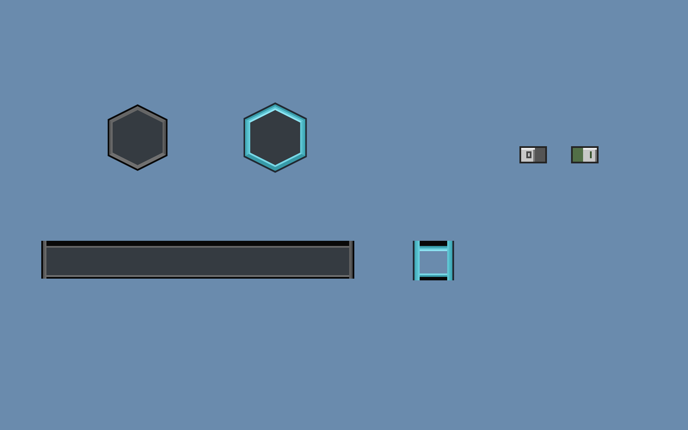
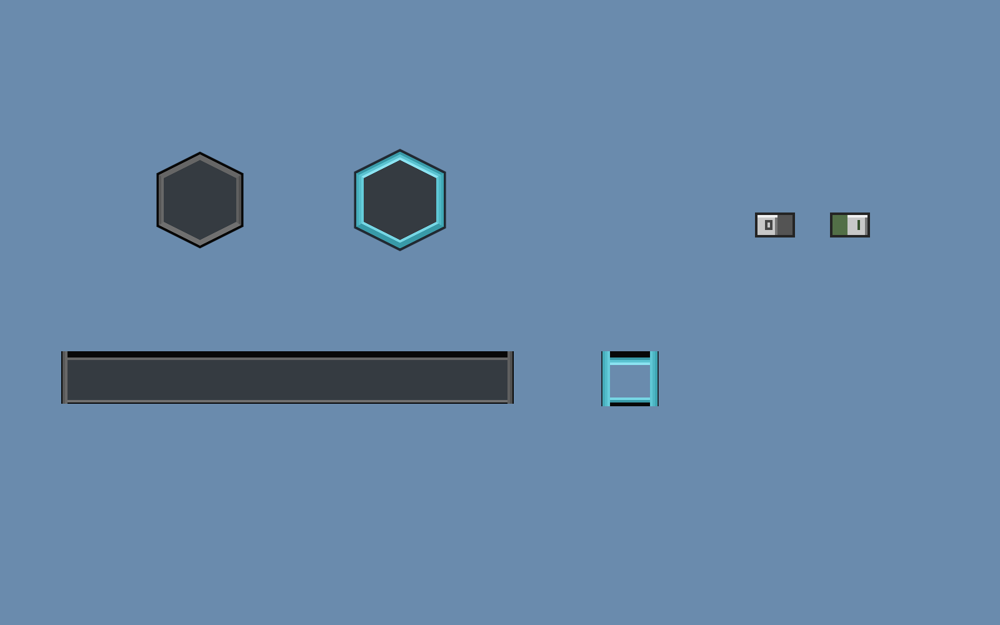

# Release verification

**Blockwheel 1.0.0 — initial public release.** Verified November 24, 2026.

## Executed checks

| Check | Result |
| --- | --- |
| Resource-pack frame build | Passed; production and sources JARs rebuilt |
| Gameplay JUnit baseline | **90 tests**, zero failures, errors or skips; unchanged by the frame correction |
| Gameplay server baseline | **All 219 required tests passed**; unchanged by the frame correction |
| Native family shape/count matrix | **3,558 conversions** verified |
| Corrected production-shape sign client | Passed: native R input, all eight wood choices, stack limits and Builder off/on sources |
| Full native gameplay baseline | Passed with Mod Menu 20.0.3, Tweakeroo 0.29.5 and MaLiLib 0.29.5 before the frame correction |
| Native vanilla frame pixels | Passed at GUI scales 2, 3 and 4 before/after pack reload: 300 bottom-band probes plus existing texture/color/width checks |
| Synthetic resource-pack pixels | Passed: 900 bevel probes across all six edges, two pack resolutions and GUI scales 2/3/4; fixed border widths, shell alpha and floor density retained |
| Border-profile checks | Passed: 90 checks covering 1×/2×/4× artwork, normal/selected strips, unequal border widths, transparent padding and ambiguous-texture fallback |
| Vanilla appearance | Complete reference images are pixel-identical to the preceding corrected 1.0.0 build at all three GUI scales, including after restoring vanilla |
| Metadata | Exact public version `1.0.0`; Minecraft 26.2, Java 25, Loader 0.19.5 and Fabric API 0.160.0+26.2 retained |

The current frame-reference/resource-pack and sign-preview runs use byte-identical copies of the delivered JAR. The original full gameplay/client baseline predates these renderer changes. Gameplay classes, family data, configuration and network logic remain unchanged; this update adds only client frame sampling, a sprite-image accessor and its mixin registration. The unrelated gameplay suites were not rerun. The source JAR matches all 69 production Java files. Test fixtures, headless support, optional mods and Minecraft assets are excluded from the release JAR. The source project includes complete code, tests, data, configuration examples, guides, a single public-release changelog and 55 native captures.

## Resource-pack outline sampling

Fixed vanilla UV rows can land inside a resource pack's thicker outer outline. Stretching those rows into the nominal gray bevel makes a wide black cap along the radial's top edges. The new profile reads the loaded sprite pixels, separates outline/padding from the colored bevel for each side, and fits the identified colors to the existing two/three GUI-pixel bands. It samples the shell at a real source-pixel center, including with HD transparent padding. A per-sprite weak cache follows resource reloads without repeated image reads or retained old atlases.

Native fixtures create two entirely synthetic packs: a standard-resolution hotbar with a three-texel black top outline and a one-texel top bevel; and a double-resolution variant with additional transparent source-pixel padding. Both use asymmetric normal/selected borders. All 900 colored-band probes pass against the live source sprites, including near each corner. The source coordinates used by the previous renderer deliberately land in the synthetic black outline, so the fixture reproduces the reported cause. Shell width/alpha, interior density and normal/selected geometry are also checked. Separate profile assertions cover quadruple-resolution artwork and safe fallback when a texture is ambiguous.

The test switches from vanilla to each pack, waits for the actual resource reload and loading overlay to finish, and restores vanilla. All complete vanilla reference images, before and after reload, are pixel-identical to the preceding corrected 1.0.0 build at GUI scales 2, 3 and 4. The user's actual pack was not supplied and is not claimed as tested.

Synthetic standard-resolution pack, normal/selected radial frames and their source sprites:



Synthetic double-resolution pack with transparent padding:



## Selected bottom highlight correction

The 24×23 selection sprite has its bottom colored bands in rows 20, 21 and 22. The normal hotbar has a separate final black row; sharing its bottom-row offset made the selected innermost band sample transparent row 19 instead. That exposed the world/background color along the bottom, especially visibly at the bottom-right join.

That earlier correction selected the proper final colored rows. The adaptive profile retains those exact vanilla coordinates. Its native-pixel regression originally failed by reading the flat background instead of the opaque highlight. The current build passes all 300 bottom-band probes before and after pack reload at GUI scales 2/3/4, including both bottom edges and every band. Existing palette, alpha, texture density, border-width, straight-edge and frameless-control checks also pass.

The gameplay baseline below remains the original 1.0.0 verification. Source comparison limits this follow-up to client rendering and its accessor registration; no inventory, networking, configuration or material calculations changed.

## Wooden sign discovery and vanilla accounting

The native recipe manager checks all twelve registered standing-sign wood types. Each recipe uses six species-matching planks and one stick and returns three signs. Ignoring the stick therefore gives two planks per sign: slab 1, plank/stair/fence 2, sign 4 and optional trapdoor 6 units. Experimental logs and wood each have eight units.

The data-defined sign form uses `minecraft:standing_signs`, with inferred bases scoped to `minecraft:planks`. Unit tests verify irregular modded names, recipe links, base-tag scope and naming fallback. A tagged nonwood sign cannot attach to a nonwood base through ordinary discovery. Explicit server data overrides remain authoritative. Hanging signs are not standing signs and remain outside these families.

| Verified case | Result |
| --- | --- |
| Six planks → signs, Builder Mode off | Three signs |
| Three signs → planks | Six planks; no sticks fabricated |
| 64 planks → signs, experimental wood off | Sixteen held signs and 32 raw planks in storage |
| Sixteen signs → slabs | 64 slabs |
| One held plank plus seven stored planks, Builder off → sign | One sign; six stored planks remain |
| One log → signs, experimental wood enabled | Two signs |
| Three signs → logs | One log plus one unchanged sign |
| One log held and three stored, Builder on → signs | Eight held signs; stored logs consumed |

Signs use their real **16-item stack limit**. The one-stack cap, main-inventory source boundaries and physical overflow policy remain shared with other shapes. Builder Mode off does not consolidate stored target items or broadly consume other family forms.

## Canonical wood remains logs and planks

Adding signs exposed a generic change-planning issue: minimizing the number of physical items could prefer a sign and a plank over three planks. The shared composition engine now supports an optional secondary storage form, after the primary form and before other necessary physical fractions. Expanded wood families use logs, then planks. Manual client/server planning uses that same preference; restock and supply change use the shared family composition.

The existing three-argument composition API retains its original behavior. The secondary preference adds no fractional balances, rounding or shape-specific conversion mathematics.

| Verified case | Result |
| --- | --- |
| Automatic 67 stairs | Sixteen logs and three planks |
| Capped manual 63 stairs → slabs, experimental wood on | 64 held slabs, seven logs and three planks; no new signs as change |
| One sign normalized | Two planks |
| Three signs normalized with experimental wood | Six planks, without adding a log/remainder slot |
| Four signs normalized with experimental wood | Two logs |
| Explicit custom 4:3 log/wood relationship | Original lossless batches and physical wood remainders preserved |

New tests include 4,000 randomized secondary-composition inputs, asserting exact value and distinct physical parts. Retained tests include 4,000 mixed-source unit cases, 6,000 custom-ratio manual cases, 350 native normalization cases, 200 native manual family cases and 120 native template-packing cases. Automatic candidates must not increase occupied main-inventory slots.

## Restock, pick block and shulkers

New native tests verify sign hand restocking from main planks, actual 16-item capacity, species separation and exclusion of other hotbar sources. Explicit pick block can use the held unstripped log to produce signs. Named remote supply leaves its final protected log: four stored logs can supply six additional signs while preserving one log. Main-only named-template filling turns 30 stored planks into fifteen signs, topping a one-sign template up to sixteen without consuming held planks.

The ordinary-stack checks protect sign block-entity data from radial conversion, normalization and compatible-family supply. Hanging signs and stripped logs remain outside transformation families; ordinary exact-item handling remains available.

Retained native fixtures cover every earlier gameplay policy: radial cancellation and rebinding, basic versus Builder consolidation, capped output and raw material, pickup routing, direct-slot and shift-click normalization, hand restock, exact/family pick, anvil/copper fallbacks, source priorities, named reserves, ender policy, saved-world reopen and dedicated reconnect. Quick deposit remains main-only; a 600 ms hold adds the hotbar once and cannot fire again on release. Actual button progress and new-material-after-hold checks pass.

## Radial and configuration

Signs reserve bottom-left without moving the cardinal forms, log, wood or trapdoor. The sign fixture points at every one of the eight native wooden choices and verifies its label, then uses real hold-R/release input to convert. Unit coverage also preserves an existing bottom-left wall/fence alternate in custom families, routing a conflicting sign to another gap or page.

The neutral center, nearest-node selection, visible cursor, compact scaling, hotbar visibility, straight frame edges, native sprite colors/texture and absence of radial dimming are retained. All six Mod Menu settings pages and current UI interactions remain covered by the full client fixture set. Existing settings, unbound key defaults and saved preferences are preserved.

## Captures and release files

All 55 captures are unedited native 1.0.0 runtime images. The three hotbar references and three sign examples are refreshed from the resource-pack-aware frame build; two synthetic pack references are added. The other captures illustrate the unchanged gameplay baseline. Some full-suite diagnostics include an extra Button shape supplied by the test data pack. The three sign examples use production shape definitions only:

- [Default sign wheel](sign-wheel.png)
- [All eight wooden forms](sign-full-wood-wheel.png)
- [Sixteen-sign output cap](sign-stack-limit.png)

The public JAR and metadata use version **1.0.0**, with no private development-version suffix. The public changelog starts with this initial release. Source packaging checks every included file and ZIP CRC, the embedded release JAR, dependency declarations and documentation links.

## Environment and practical limits

Tests use Minecraft 26.2, Java 25.0.1, Gradle 9.5.1, Loom 1.17.21, Loader 0.19.5 and Fabric API 0.160.0+26.2. Native rendering uses software OpenGL/EGL and GLFW's null platform at 1600×1000. Vulkan and WAN loss/latency are not exercised. There is no audio device, so sound requests and feedback are checked without claiming subjective loudness testing.

Hanging signs, shelves and stripped transformation families are not implemented. Modded wood types need reliable tags/recipes or explicit data definitions. Only the described synthetic hotbar packs are tested. Radically rearranged artwork or an indistinguishable bevel falls back to vanilla coordinates; interior artwork still assumes the native floor-patch layout. Animated packs need a consistent border layout across frames. The user's exact hotbar pack and the unidentified private ender side-panel mod are not individually claimed as tested. The hold threshold remains fixed at 600 ms. Storage and capacity limits can leave physical remainders; accepted transactions never discard them to improve packing.

Release JAR SHA-256:

```text
904dd126c7dbc0dd6288617128da62142fca787cbab912528a8fa8587d7f3717
```
